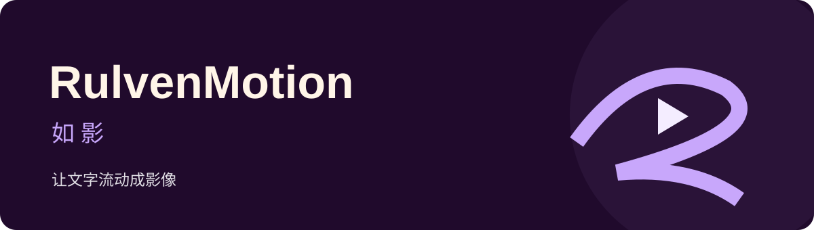

### 让文字流动成影像

**AI 视频 · 动态叙事 · 创作 Agent**

## 我们的创作方向

从文字构思走向动态表达，探索 AI 视频制作与创作 Agent，把叙事、镜头和制作步骤串联起来。

| 方向 | 探索内容 |
| --- | --- |
| 文字到影像 | 内容构思、剧本、分镜与动态叙事 |
| 影像制作 | 视频生成、镜头编排、声音与后期 |
| 创作 Agent | Skills 组合、工具协作与制作流程自动化 |

## 一起开始创作

项目正在起步，我们会结合实际创作逐步整理并发布 Skills、工作流和工具。

欢迎关注组织仓库，在具体项目的 Issue 中交流创意、使用体验和改进建议。
